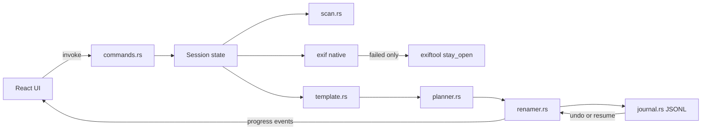

# Requirements

### 概要と目的
既存の CLI スクリプト `rename_picture_files_to_timestamp.py` と同じ処理（EXIF の撮影日時でファイル名を変更）を、**Tauri v2 + TypeScript** の GUI アプリとして作り直します。Windows・macOS・Linux で動きます。
- ドラッグ＆ドロップで対象を指定する
- 実行前に変更後の名前を確認・調整できる
- 1件ずつ順番に処理し、進み具合が見える
- **数万件**でも安全・頑強・高速に処理できる

### 対象範囲
#### 対象に含めるもの
- 新しいアプリを `app/` 配下に追加（`src-tauri/` が Rust、`src/` が React + TS）
- ドロップしたファイルやフォルダを読み込む（サブフォルダも含む。オプションで直下のみに切り替え可）
- 撮影日時の読み取り：通常は `kamadak-exif` を使い、読めなかったファイルだけ同梱の `exiftool` で読み直す（Windows でも HIF を処理可能）
- テンプレート形式の命名（任意の固定文字＋トークン）
- プレビュー：新旧ファイル名の一覧、EXIF 情報、ファイルごとの除外・手動編集
- 安全機構：事前の衝突チェック（自動で連番を付ける／スキップ）、リネーム履歴の記録と Undo、処理の中断と再開
- README に GUI 版の説明を追加
#### 対象外
- 既存の Python スクリプトの変更・削除（そのまま残します）
- ���像サムネイルの表示
- 撮影日時の書き換えや、ファイルの移動・コピー
- インストーラへの署名と自動アップデート

### ユーザーストーリー
- 写真の管理者として、フォルダをウィンドウにドロップするだけで、全写真を撮影日時の名前に変えたい。毎回コマンドを打たなくて済むように。
- 変更後の名前を実行前に一覧で確認し、固定文字を変えたらすぐに反映されてほしい。失敗を防ぐために。
- 数万件の処理中に、今どのフ���イルを処理しているか、何件終わったかを見たい。安心して待てるように。
- 間違えてリネームしても、一括で元に戻したい。
- 途中で止めたりアプリが落ちたりしても、続きから再開するか、元に戻したい。

### 機能要件
1. **読み込み**：ウィンドウ全体がドロップ先になる。ファイルとフォルダを混ぜてドロップできる。追加でドロップすると対象に足され、同じパスは重複して追加しない。隠しファイルと、対応する拡張子のリスト（変更可）以外のファイルは対象にしない。
2. **撮影日時**：`DateTimeOriginal` を優先し、なければ `DateTimeDigitized`/`CreateDate` を使う。どちらも取れないファイルは「日時なし」としてスキップする（現行と同じ）。
3. **テンプレート**：初期値は `IMG_{date:YYYYMMDD_HHmmss}_{name}` で、`IMG_20230223_125312_7M400001.ARW` のようになる（現行の出力と同じ）。使えるトークンは `{date:FORMAT}`、`{name}`（元のファイル名から拡張子を除いた部分）、`{seq:N}`（N桁の連番）、`{camera}`。それ以外の文字はそのまま固定文字として入る。拡張子は元のまま残す（大文字・小文字の変換はオプション）。入力内容はすぐにプレビューに反映される。
4. **プレビュー一覧**：仮想スクロールで、数万行でもスムーズに動く。列は「対象チェック／元の名前／新しい名前／撮影日時／状態」。状態は OK・衝突・日時なし・変更なし・除外・エラーのいずれか。状態で絞り込める。行を選ぶと横のパネルに EXIF 情報（日時・メーカー・機種・読み取り方法）を表示する。新しい名前のセルはダブルクリックで手動編集できる。
5. **衝突チェック**：実行前に次を検出する。
   - 新しい名前同士の重複（同じフォルダ内。大文字・小文字の違いだけのものも含む）
   - 対象外の���存ファイルとの衝突
   - ファイル名に使えない文字や、Windows の予約名
   
   衝突の扱いは「自動で連番 `_001` を付ける」（初期値）か「スキップ」から選ぶ。すでにテンプレート形式になっているファイルは「変更なし」としてスキップする。
6. **実行**：1件ずつ順番にリネームする。進み具合のバー、完了・スキップ・エラーの件数、現在処理中のファイル、1秒あたりの件数、残り時間の目安、ログを表示する。キャンセルボタンで中断できる。
7. **履歴と Undo**：1回の実行ごとに履歴ファイルを残す。履歴の画面から、その実行の分を一括で元の名前に戻せる。
8. **再開**：起動時に途中で終わった実行が見つかったら、「続きから再開」か「元に戻す」かを選べるようにする。

### 非機能要件
- 性能：SSD 上の 5万件で、読み込みとプレビューが数十秒以内、テンプレート変更の反映が約 200ms 以内になることを目指す
- 安全性：既存ファイルを上書きしない。各リネームの前後に履歴を書き込み、アプリが落ちても状態を復元できるようにする
- 対応 OS：Windows 10 以降、macOS、Linux

# Technical Design

### 現在の実装
- `rename_picture_files_to_timestamp.py`：引数で受け取ったフォルダの直下を `os.listdir` で列挙します。撮影日時は macOS では `sips -g creation`、それ以外では `exifread` の `EXIF DateTimeOriginal` から読みます。新しい名前は `IMG_{日時から ':' を除き空���を '_' にしたもの}_{元の名前}.{拡張子}` で、`os.rename` で変更します。重複チェック、上書き防止、Undo はありません。
- 現行の `{name}` は `"".join(name.split(".")[:-1])` で作っているため、名前の途中にある `.` が消えます。新しいアプリでは `Path::file_stem` を使い、途中の `.` は残します（意図した変更です）。
- README の��（`2023-02-23_12-53-12_...`）は実際の出力と違います。初期値はコードの出力に合わせ、README も直します。

### 主な決定事項
- **Tauri v2 + React + TypeScript + Vite**：配布サイズを小さく保てます。重い処理はすべて Rust 側で行います。
- **Rust 側でまとめて処理**：読み込みから EXIF 読み取り、名前の決定、リネームまでを Rust の `Session` が持ちます。UI へは、まとめた進捗イベント（約10回/秒）とページ単位の行データだけを送ります。数万件でも IPC の負荷が大きくなりません。
- **EXIF**：`rayon` で並列に `kamadak-exif` で読みます（TIFF 系 RAW、JPEG、HEIF に対応）。読めなかったファイルだけをまとめて、常駐させた `exiftool -stay_open True -@ -` に 500件ずつ JSON で問い合わせます。exiftool は `bundle.resources` に同梱したもの → PATH 上のもの の順に探し、見つからなければ補助なしで動かします（UI に警告を表示）。
- **安全なリネーム**：
  - 履歴ファイル（JSONL）に「これから変更する」と書いてから変更し、終わったら「完了」と書きます（先に書くことで落ちても状態が分かります）。
  - 上書きしない形でリネームします（Linux は `renameat2(RENAME_NOREPLACE)`、macOS は `renamex_np(RENAME_EXCL)`、Windows はフラグなしの `MoveFileExW`）。`std::fs::rename` は上書きしてしまうため使いません。
  - 変更先が、同じ実行でこれから名前が変わる別のファイルと同じ場合（A→B、B→C のような連鎖）は、いったん一時名を経由する2段階で変更します。
- **ドロップ**：HTML5 のドロップではファイルのパスが取れないため、Tauri v2 の `getCurrentWebview().onDragDropEvent` を使います。
- **状態管理**：`zustand` を使い、一覧は `@tanstack/react-virtual` で表示します。

### 処理の流れ
1. `scan_paths(paths, recursive)`：`jwalk` で並列に列挙し、拡張子リストで絞り込み、パスの重複を除いて `Session.items` に追加します。進捗イベントを出します。
2. `read_metadata()`：まず kamadak-exif で並列に読み、失敗した分を exiftool で読み直します。結果は各項目の `exif` に保存します。
3. `build_plan(template, options)`：全件について新しい名前を作り、衝突を判定して `PlanSummary` を返します。テンプレートを変えるたびに UI から約 200ms の間隔を空けて呼びます。
4. `get_rows(offset, limit, filter)`：仮想スクロールで見えている範囲の行だけを取得します。
5. `set_override(id, excluded?, manual_name?)`：除外や手動編集を反映し、衝突を判定し直します。
6. `execute_rename()`：別スレッドで1件ずつ変更し、`rename-progress` イベントを出します。`cancel_job()` は `AtomicBool` で中断を伝えます。
7. `list_journals()`、`undo_job(id)`、`resume_job(id)`：履歴の一覧、Undo、再開を行います。Undo と再開でも、各ファイルが「元の場所にあること」「変更先が空いていること」を確かめてから処理します。

### アーキテクチャ図


### データモデルと契約
```rust
// session.rs
struct Item { id: u32, path: PathBuf, dir: PathBuf, stem: String, ext: String,
  exif: Option<ExifInfo>, exif_error: Option<String>,
  excluded: bool, manual_name: Option<String>,
  planned: Option<String>, status: ItemStatus }
struct ExifInfo { taken_at: NaiveDateTime, source: ExifSource /*Native|ExifTool*/,
  make: Option<String>, model: Option<String> }
enum ItemStatus { Ok, Conflict(String), NoTimestamp, Unchanged, Excluded, Error(String), Done, Skipped }

// template.rs
enum Token { Literal(String), Date(String), Name, Seq(usize), Camera }
fn parse(tpl: &str) -> Result<Vec<Token>, TemplateError>;
fn render(tokens: &[Token], item: &Item, seq: usize) -> String;

// planner.rs
struct PlanOptions { on_conflict: Resolve /*Suffix|Skip*/, ext_case: ExtCase, skip_already_named: bool }
struct PlanSummary { total: u32, ok: u32, conflict: u32, no_ts: u32, unchanged: u32, excluded: u32 }

// progress event payload (throttled)
struct Progress { phase: Phase /*Scan|Exif|Rename|Undo*/, done: u32, total: u32,
  current: Option<String>, ok: u32, skipped: u32, errors: u32, rate: f32, recent: Vec<LogLine> }
```
履歴ファイルの形式（`<appData>/journals/<jobId>.jsonl`）：
```
{"type":"header","job":"...","created":"...","template":"...","count":50000}
{"type":"intent","seq":1,"from":"C:/p/a.ARW","to":"C:/p/IMG_..._a.ARW","via":null}
{"type":"done","seq":1}
{"type":"footer","state":"completed|cancelled"}
```
footer がない履歴は「途中で終わった実行」として扱います。書き込みは毎件 `flush` し、`fsync` は 200件ごとと終了時に行います。

### ファイル構成
```
app/
  package.json, vite.config.ts, tsconfig.json, index.html
  src/
    main.tsx, App.tsx, types.ts
    api/commands.ts, api/events.ts      // invoke と listen の型付きラッパー
    store/sessionStore.ts               // zustand
    components/DropZone.tsx, TemplateEditor.tsx, PreviewTable.tsx,
               ExifPanel.tsx, ProgressPanel.tsx, LogView.tsx, HistoryDialog.tsx
  src-tauri/
    Cargo.toml, tauri.conf.json, capabilities/default.json, build.rs
    resources/exiftool/                 // 同梱する exiftool（OS ごと）
    src/main.rs, lib.rs, commands.rs, session.rs, scan.rs,
        exif/mod.rs, exif/native.rs, exif/exiftool.rs,
        template.rs, planner.rs, renamer.rs, fsops.rs, journal.rs, progress.rs
    tests/fixtures/                     // EXIF 付きの小さなテスト用画像
README.md                               // GUI 版の説明を追記し、例を修正
```
主な依存ライブラリ：Rust 側は `tauri 2`、`kamadak-exif`、`rayon`、`jwalk`、`chrono`、`serde`/`serde_json`、`uuid`、`windows-sys` / `libc`（上書きしないリネーム用）。TS 側は `react`、`zustand`、`@tanstack/react-virtual`、`@tauri-apps/api`。

### リスク
- **exiftool の同梱**：Windows 版は最近の版で exe とフォルダの構成です。macOS と Linux は perl が必要です。→ resources に同梱し、PATH 上のものを代わりに使えるようにし、使えなければ警告を出して補助なしで続けます。
- **ネットワークドライブや FAT/exFAT**：上書きしない形のリネームが使えない場合があります。→ 直前に存在を確かめてから変更する方式に切り替え、衝突したらエラーにします。
- **大文字・小文字を区別しないファイルシステム**（Windows/macOS）：衝突チェックは小文字にそろえたキーで行います。
- **二重に付く接頭辞**：再実行で `IMG_..._IMG_...` になるのを防ぐため、`skip_already_named` を初期値で有効にします。
- **ビルド環境**：Rust（MSVC）と Node、WebView2 が必要です。

# Testing

### 確認の方針
- 主な処理（テンプレート、衝突チェック、リネーム、履歴）は Rust にあるため、`cargo test` で `tempfile` の一時フォルダを使った統合テストを中心に確認します。
- フロントエンドは `tsc --noEmit` と `vite build` が通ることを確認し、`cargo build` でアプリ全体がビルドできることも確認します。

### 主なシナリオ
- **EXIF**
  - テスト用画像（JPEG、および TIFF 系の小さなファイル）から `DateTimeOriginal` を読める
  - EXIF のないファイルは「日時なし」になる
- **テンプレート**
  - 初期値で `7M400001.ARW` → `IMG_20230223_125312_7M400001.ARW` になる（現行と同じ）
  - `{date:YYYY-MM-DD}`、`{seq:3}`、`{camera}`、固定文字が正しく展開される
  - 不正なテンプレートはエラーになる
- **衝突チェック**
  - 同じ秒に撮影された複数ファイルが重複として検出され、`_001` が付く（またはスキップされる）
  - 対象外の既存ファイルとの衝突を検出する
  - 大文字・小文字の違いだけの重複を検出する
  - 「変更なし」を正しく判定する
- **リネーム**
  - 全件が予定どおりの名前に変わり、履歴に header・intent・done・footer が揃う
  - A→B、B→C の連鎖が一時名経由で正しく処理される
- **Undo**：実行後に `undo_job` を呼ぶと、すべて元の名前に戻る
- **中断と再開**
  - 途中でキャンセルすると footer が `cancelled` になる
  - footer のない履歴を `resume_job` で再開すると、残りだけが処理される

### 境界ケース
- 変更先にあとから同名のファイルが作られた場合、上書きせずにエラーとして記録する
- 名前の途中に `.` があるファイルや、拡張子のないファイル
- Windows で使えない文字（`:` など）や予約名（`CON` など）が手動編集で入力された場合
- exiftool が見つからない場合でも、補助なしで処理が続く

### 追加するテスト
- `src-tauri/src/template.rs`、`planner.rs`、`journal.rs` に単体テストを置く
- `src-tauri/tests/rename_flow.rs` に、リネーム・Undo・再開の統合テストを置く
- `src-tauri/tests/perf.rs`（`#[ignore]`）：2万件のダミーファイルで、名前の決定とリネームにかかる時間を測る

# Delivery Steps

### ✓ Step 1: Tauri v2 + React アプリの土台を app/ に作成
`app/` に Tauri v2 + React + TS のアプリの土台ができ、起動して Rust と画面の間で呼び出しとイベントのやり取りができる状態になる。
- Vite + React + TS のプロジェクトを作り、`src-tauri/` を初期化する（`tauri.conf.json` と `capabilities/default.json`）
- Rust のモジュールの骨組みを作る（`commands.rs`、`session.rs`、`progress.rs`）。`Session` は Tauri の state として保持する
- 約10回/秒にまとめて進捗イベントを送る仕組みを `progress.rs` に作る
- TS 側に型付きのラッパー（`api/commands.ts`、`api/events.ts`）と `types.ts` を作る
- 依存ライブラリ（zustand、@tanstack/react-virtual など）を追加し、`cargo build` と `vite build` が通ることを確認する

### ✓ Step 2: ファイルの読み込みと EXIF 読み取り（exiftool 補助つき）を実装
ドロップしたパスから対象ファイルを並列に列挙し、撮影日時と機種を読み取れるようになる。
- `scan.rs`：`jwalk` でサブフォルダまで列挙する（直下のみも選べる）。拡張子リストと隠しファイルで絞り込み、パスの重複を除いて `scan_paths` として公開する
- `exif/native.rs`：`rayon` で並列に `kamadak-exif` から読む（DateTimeOriginal を優先し、なければ DateTimeDigitized、あわせて Make と Model）
- `exif/exiftool.rs`：常駐させた `-stay_open` のプロセスに、失敗したファイルを 500件ずつ JSON で問い合わせる。同梱 → PATH の順で exiftool を探し、見つからなければ補助なしで動かす
- `read_metadata` を公開し、進捗イベントを出す
- テスト用画像を使い、EXIF の読み取りと日時なしの判定を単体テストで確認する

### ✓ Step 3: テンプレートの処理と、名前の決定・衝突チェックを実装
テンプレートから全件の新しい名前を作り、衝突と状態を判定し、一覧の行をページ単位で返せるようになる。
- `template.rs`：`{date:FORMAT}`、`{name}`、`{seq:N}`、`{camera}` と固定文字を扱う。初期値は `IMG_{date:YYYYMMDD_HHmmss}_{name}`
- `planner.rs`：次を判定し、`PlanSummary` を返す
  - 同じフォルダ内での重複（大文字・小文字を区別しない）
  - 既存ファイルとの衝突
  - 使えない文字と予約名
  - 衝突時に連番を付けるかスキップするか、「変更なし」、すでにリネーム済みかどうか、拡張子の大文字・小文字
- `build_plan`、`get_rows(offset, limit, filter)`、`set_override` を公開する
- テンプレートの展開と衝突の各パターンを単体テストで確認する（現行と同じ出力になることも含む）

### ✓ Step 4: 履歴つきの安全なリネーム、中断・再開・Undo を実装
1件ずつ上書きせずにリネームし、すべてを履歴に記録し、キャンセル・再開・Undo ができるようになる。
- `fsops.rs`：OS ごとに上書きしないリネームを実装する（renameat2、renamex_np、MoveFileExW）。使えない場合は存在を確かめてから変更する方式にする
- `journal.rs`：JSONL に header・intent・done・footer を書く。毎件 flush し、200件ごとに fsync する
- `renamer.rs`：別スレッドで順番に実行する。連鎖する変更は一時名を経由する2段階で行い、`AtomicBool` で中断し、進捗とログをイベントで送る
- `execute_rename`、`cancel_job`、`list_journals`、`undo_job`、`resume_job` を公開する
- `tests/rename_flow.rs` で、実行・連鎖・Undo・キャンセル後の再開・後から作られた同名ファイルを確認する。`tests/perf.rs`（ignore）で2万件の処理時間を測る

### ✓ Step 5: ドロップ・テンプレート編集・プレビュー一覧の画面を実装
ドロップした写真の新旧ファイル名が仮想スクロールの一覧に表示され、テンプレートの変更・除外・手動編集がすぐに反映されるようになる。
- `DropZone.tsx`：`onDragDropEvent` でパスを受け取り、読み込みと EXIF 読み取りを呼ぶ
- `TemplateEditor.tsx`：テンプレートの入力欄、トークンの挿入ボタン、衝突時の扱いなどのオプションを置く。約200ms の間隔を空けて `build_plan` を呼ぶ
- `PreviewTable.tsx`：`@tanstack/react-virtual` で表示し、`get_rows` でページ単位に取得する。状態での絞り込み、チェックでの除外、ダブルクリックでの手動編集ができる
- `ExifPanel.tsx`：選んだ行の日時・機種・読み取り方法を表示する
- `store/sessionStore.ts`（zustand）で状態をまとめる

### ✓ Step 6: 進捗表示・実行と中断・履歴と Undo の画面を作り、README を更新
実行中の状況がリアルタイムに見え、キャンセル・Undo・起動時の再開を画面から操作できるようになる。
- `ProgressPanel.tsx`：進み具合のバー、完了・スキップ・エラーの件数、現在のファイル、1秒あたりの件数、残り時間の目安、キャンセルボタンを置く
- `LogView.tsx`：直近のログを仮想スクロールで表示し、一覧の各行の状態も更新する
- `HistoryDialog.tsx`：履歴の一覧から Undo できるようにする。起動時に途中で終わった実行が見つかったら、再開か元に戻すかを選ぶダイアログを出す
- README に GUI 版のビルド方法と使い方を追記し、命名例を実際の出力に合わせて直す
- `tsc --noEmit`、`vite build`、`cargo test` が通ることを確認する